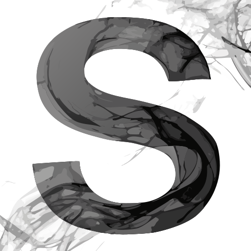

html<div align="center">


# Shaya

**AI assistant tool for Linux.**

</div>

Shaya lives as an overlay on desktop and gives you instant access to AI chat, voice transcription, screenshots, meeting recording & analysis. A fast and quiet tool during deep work. 

Invisible to screen sharing on Wayland (as much as possible).

One Rust binary. Pure GTK4. No compromises.

## Features

| | |
|---|---|
| **AI Chat** | Groq, OpenAI, Anthropic — conversation with context, markdown rendering, system prompts |
| **Voice Capture** | Record microphone or system audio, automatic transcription |
| **Screenshots** | Full screen or area selection, auto-attached to chat as context |
| **Meeting Recorder** | Capture mic + system audio, transcribe, get AI analysis |
| **Prompt Library** | Manage and switch system prompts for different scenarios |
| **Cheatsheets** | Quick-access markdown notes with live preview |
| **Conversation History** | Browse, continue, or delete past sessions |
| **Appearance** | Adjustable opacity, light/dark theme |
| **Quick Toggle** | Bind any shortcut via DE settings or compositor config; re-run binary to show/hide |
| **Privacy** | BYOK (bring your own key) — no cloud, no servers, data never leaves your machine |
| **Stealth Mode** | Wayland overlay, hidden as much as possible |

Bring your own API key — Anthropic, OpenAI, or Groq. LLM supports all three providers; STT supports Groq and OpenAI. Groq is especially recommended for STT and fast responses.

---

## Why Shaya Was Built

Most existing AI assistants of that class ship bloated Electron/WebView wrappers that eat RAM and feel alien on Linux.

Shaya is a **boutique tool** built for Linux users who care about their stack:

- **GTK4 + libadwaita** — GNU/GNOME native, first-class Wayland citizen
- **Layer Shell** — compositor-level overlay via wlr-layer-shell protocol
- **Single binary** — no runtime, no daemon, no dependencies beyond GTK
- **Privacy-first** — your API keys stay local, nothing phones home

#### Overlay Behavior

Shaya uses Wayland layer-shell to render as a compositor overlay. How it appears during screen sharing depends on your compositor:

> See [Stealth Guide](docs/STEALTH_GUIDE.md) for compositor setup, workarounds, and cross-platform research.

---

## Install

Shaya builds from source into one binary. COPR and AUR packages are planned.

Install [Rust](https://rustup.rs) and the system libraries:

```bash
# Fedora
sudo dnf install gcc gtk4-devel libadwaita-devel gtk4-layer-shell-devel
# Arch
sudo pacman -S --needed base-devel gtk4 libadwaita gtk4-layer-shell
# Debian 13+, Ubuntu 25.10+
sudo apt install build-essential pkg-config libgtk-4-dev libadwaita-1-dev libgtk4-layer-shell-dev
```

Then build and run:

```bash
cargo install --locked --git https://github.com/AshBuk/Shaya
shaya
```

To remove it, run `cargo uninstall shaya`.

Audio and screenshots use system tools, listed in [DEVELOPMENT](docs/DEVELOPMENT.md#system-tools-at-runtime).

---

## Stack

| Layer | Technology |
|-------|------------|
| Language | Rust |
| UI | GTK4 + libadwaita |
| Stealth | gtk4-layer-shell (`zwlr-layer-shell-v1`) |
| AI | Groq / OpenAI / Anthropic (LLM), Groq / OpenAI (STT) |
| Audio | PipeWire / PulseAudio via `parecord` |
| Screenshots | grim, spectacle, gnome-screenshot, XDG Portal |
| HTTP | ureq (blocking, background threads) |

---

## Documentation

- [CONTRIBUTING](CONTRIBUTING.md): local development, checks before a pull request
- [ARCHITECTURE](docs/ARCHITECTURE.md): project structure, design decisions, state management
- [DEVELOPMENT](docs/DEVELOPMENT.md): dependencies, build setup, scripts

### [Apache-2.0](LICENSE) LICENSE

---

Sharing with the community for privacy-conscious Linux users.

Link back to this repo and ⭐ it if it helped you.

[](https://github.com/sponsors/AshBuk) [](https://www.paypal.com/donate/?hosted_button_id=R3HZH8DX7SCJG)
